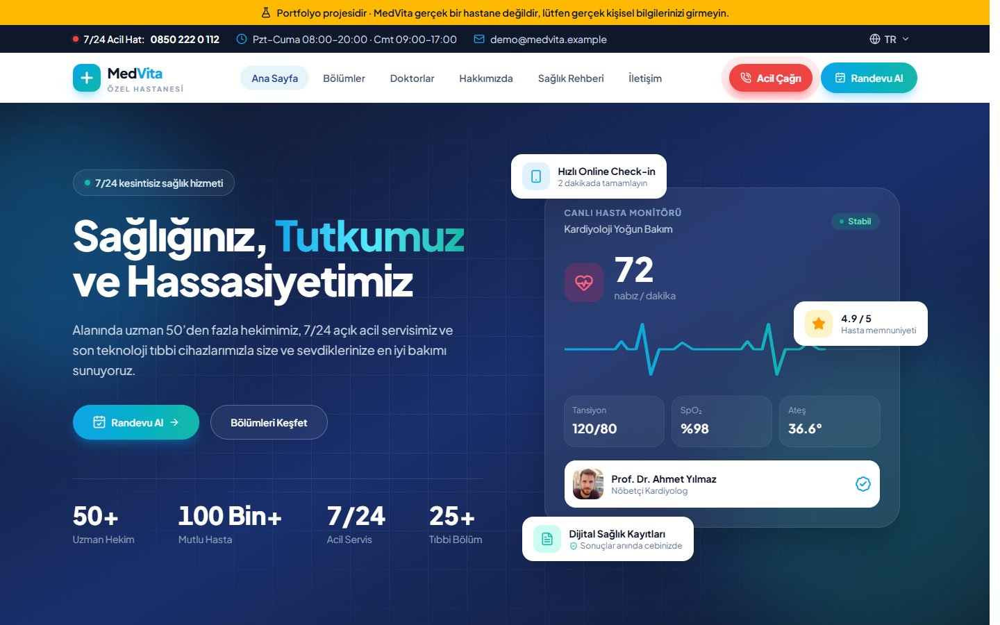
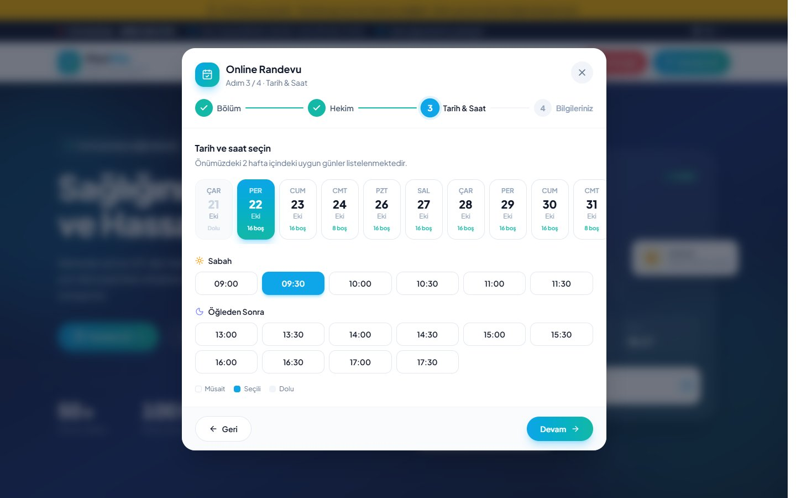
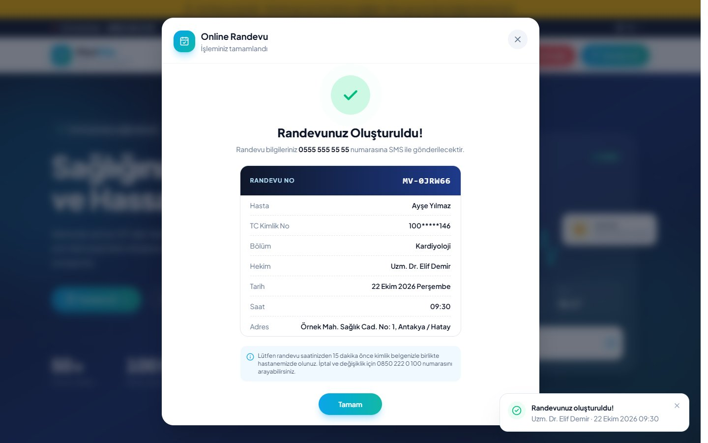
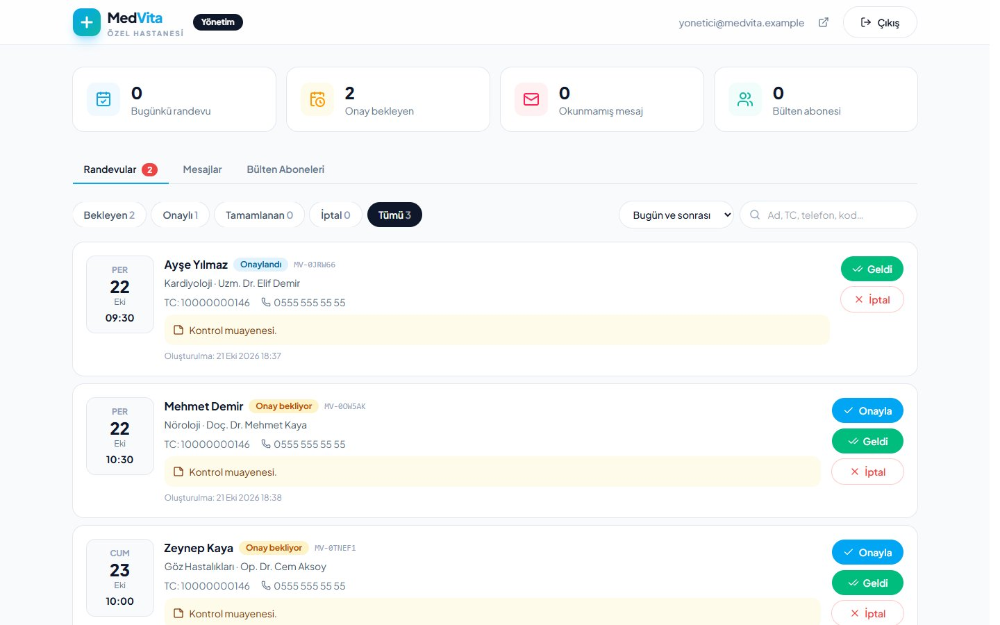
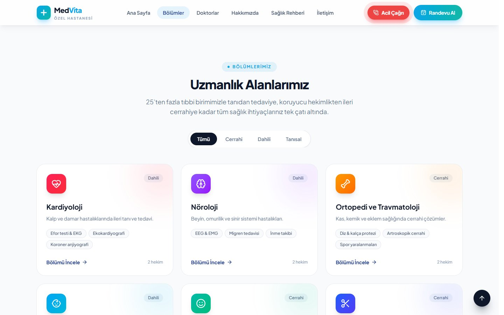
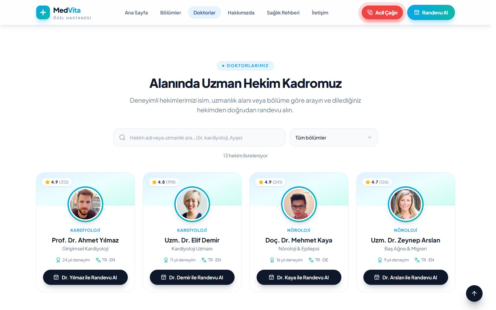
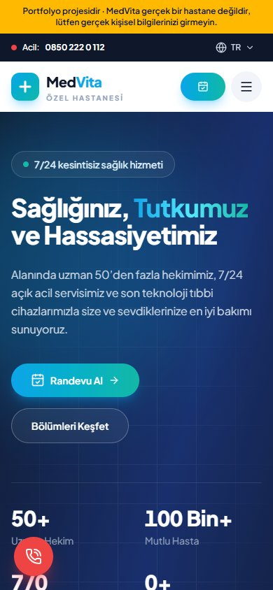
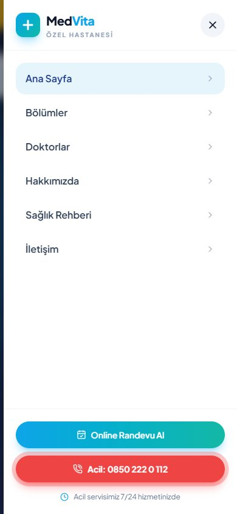

# MedVita — Özel Hastane Web Sitesi ve Randevu Sistemi


Hayali bir özel hastane için uçtan uca geliştirilmiş web uygulaması: animasyonlu tanıtım sitesi, 4 adımlı online randevu,
gerçek zamanlı yönetim paneli ve güvenlik kurallarıyla korunan Firebase backend.

**🔗 Canlı demo: [medvita-hastane-demo.web.app](https://medvita-hastane-demo.web.app)**

> MedVita gerçek bir kurum değildir; isimler, hekimler ve iletişim bilgileri örnektir. Randevu formunu denemek için
> formdaki **"Demo: örnek bilgilerle doldur"** butonunu kullanabilirsiniz.



## Öne Çıkanlar

- **Çift randevu veritabanı seviyesinde engellenir.** Randevu ve `slots/{hekim_tarih_saat}` kaydı tek bir batch'te yazılır.
  Saat doluysa slot yazımı "update" sayılır ve güvenlik kuralları tüm işlemi reddeder. Aynı anda gönderilen iki talepten
  yalnızca biri kabul edilir; diğer kullanıcı bilgilerini kaybetmeden yeni saat seçer.
- **Hasta verisi yalnızca yöneticilere açık.** Ziyaretçiler randevu oluşturabilir ama okuyamaz. Dolu saat bilgisi kişisel veri
  içermeyen ayrı bir koleksiyondan okunur. Kurallar alan tiplerini, TC Kimlik ve telefon formatını, `status` ve
  `createdAt` değerlerini sunucu tarafında doğrular. Kurallar, gerçek veritabanına karşı yazılan saldırı senaryolarıyla
  test edilmiştir (başkasının randevusunu okuma, kendini yönetici yapma, sahte durum gönderme vb.).
- **Gerçek zamanlı yönetim paneli** (`/admin`): Yeni randevular sayfa yenilemeden düşer. Onaylama, "geldi" işaretleme ve
  iptal yapılabilir; iptal edilen saat otomatik olarak tekrar randevuya açılır. Mesaj kutusu ve bülten listesinin Excel'e
  aktarımı da paneldedir.
- **Performans:** Firebase SDK'sı ve yönetim paneli ayrı parçalara bölünmüştür (code splitting). Ana sayfa açılırken
  Firestore yüklenmez, yalnızca kullanıcı randevu adımına geldiğinde indirilir.
- **Form deneyimi:** TC Kimlik No algoritma doğrulaması, telefonun yazarken otomatik biçimlenmesi, alan bazında anlık
  hata ve başarı geri bildirimi, KVKK onayı.
- **Erişilebilirlik ve detaylar:** Klavye ile kapanan modallar, `aria` etiketleri, "hareketi azalt" tercihine saygı,
  Türkçe karakterden bağımsız arama ("ayse" → "Ayşe"), KVKK gereği onayla yüklenen harita.

## Ekran Görüntüleri

| Online randevu | Randevu onayı |
|---|---|
|  |  |
| **Yönetim paneli** | **Bölümler** |
|  |  |
| **Hekimler** | **Mobil** |
|  |   |

## Özellikler

**Site:** Sabit menü ve aktif bölüm takibi, animasyonlu mobil menü, sayaçlı hero bölümü, kategori filtreli bölümler ve
detay çekmecesi, aranabilir hekim listesi, anlaşmalı kurumlar, sağlık rehberi (blog), iletişim formu, bülten aboneliği,
bildirim (toast) sistemi.

**Randevu akışı:** Bölüm → Hekim → Tarih & Saat (veritabanındaki dolu saatlerle) → Hasta bilgileri → Randevu kodu ve özet kartı.

**Yönetim paneli:** E-posta/şifre ile giriş, şifre sıfırlama, durum filtreleri, tarih aralığı ve hasta arama, mesajları
okundu işaretleme ve yanıtlama, abone listesini CSV olarak dışa aktarma.

## Teknolojiler

| Katman | Kullanılan |
|---|---|
| Arayüz | React 19, TypeScript (strict), Vite |
| Stil ve animasyon | Tailwind CSS v4, Framer Motion, Lucide ikonları |
| Backend | Firebase Firestore (europe-west3), Firebase Authentication, Firestore Security Rules |
| Yayın | Firebase Hosting |

## Proje Yapısı

```
src/
  admin/           Yönetim paneli (ayrı parça olarak yüklenir)
  components/
    appointment/   Randevu modalı, adımlar ve çalışma saatleri
    layout/        Üst bar, menü, footer, sabit butonlar
    sections/      Ana sayfa bölümleri
    ui/            Modal, çekmece, form alanı, logo…
  context/         Bildirim ve randevu context'leri
  data/            Bölüm, hekim, blog ve site verileri
  hooks/           useForm, useScrollSpy, useLockBody, useEscape
  lib/             Doğrulama, tarih biçimlendirme, animasyon varyantları
  services/api.ts  Backend ile konuşan tek katman
firestore.rules    Güvenlik kuralları
```

## Kendi Bilgisayarında Çalıştırma

```bash
npm install
npm run dev
```

`.env.local` dosyası olmadan site **demo modunda** çalışır: her şey görünür ve tıklanabilir, ancak veri kaydedilmez.

Kendi Firebase projenize bağlamak için:

1. Firebase'de bir proje ve web uygulaması oluşturun.
2. `.env.example` dosyasını `.env.local` olarak kopyalayıp web ayarlarını doldurun.
3. `.firebaserc` içindeki proje kimliğini kendi projenizle değiştirin.
4. `firebase deploy --only firestore,auth` komutunu çalıştırın (kurallar, indeksler ve e-posta/şifre girişi).
5. Authentication'dan bir kullanıcı oluşturun ve Firestore'da `admins/{kullanıcı UID}` belgesini ekleyin.
   Bu kullanıcı `/admin` adresinden panele girebilir.
6. Yayın için `npm run build`, ardından `firebase deploy --only hosting`.
